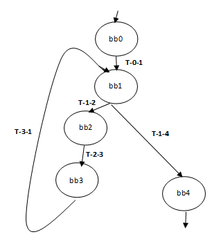

# Adding an SMT pass in the LLVM backend
This repository contains: 
- a formal pass called *RISCVmirToSMT.cpp* that transforms LLVM's Machine Intermediate Representation (MIR) to an [SMT](https://people.eecs.berkeley.edu/~sseshia/pubdir/SMT-BookChapter.pdf) formula in the [SMTLIB-v2](https://www.lri.fr/~conchon/TER/2013/2/SMTLIB2.pdf) standard.
This pass was implemented for a scalar RISC-V target architecture. It generates a separate SMT file for each function of the input application.
- a formal pass called *RISCVmirToSMTfctCall.cpp* that is similar to the *RISCVmirToSMT.cpp* pass except that it takes into account function-call instructions in the SMT formulae. It also doesn't assume that a function has one exit basic block. It accounts for all possible exit basic blocks. For more information about this pass and how it works, please refer to [README2.md](README2.md). 
- a formal pass called *RISCVmirToSMTfctCallLoopBound.cpp* that is similar to the *RISCVmirToSMTfctCall.cpp* with the addition of constraints on loop bounds. This pass allows the detection of loops and it associates a variable to each loop, which can be set to a value representing the loop bound. Memory counters of each basic block belonging to a loop are computed taking into account the loop bound.  For more information about this pass and how it works, please refer to [README3.md](README3.md).  
- a postprocessing function *merge_smt.sh* only used in case the main program has function calls. This function operates on the text file as well as the SMT files generated by the *RISCVmirToSMTfctCallLoopBound.cpp* pass. It renames the SMT variables found int the SMT files of the different functions in order to merge all these SMT files in a unique one without any conflicts in variable names (by resolving unwanted redundancies). More on this postprocessing function can be found in [README4-amended.md](README4-amended.md).
- a pass called *RISCVmirToSMTvec.cpp* that extends *RISCVmirToSMTfctCallLoopBound.cpp* by detecting and counting vector memory instructions and encoding them in SMT [README7.md](README7.md).
- a binary search algorithm *bmc.c* that verifies the satisfiability of a constraint over a given interval and an input SMT file.
- a shell script *cfgGenerator.sh* that takes as input an llvm bitcode and generates for each function its corresponding CFG in a *dot* file and its graphic representation in a pdf file. This can be useful to visualize the structure of the code especially in the presence of nested loops. For more information, take a look at  [README6.md](README6.md). 
- the standard LLVM backend passes for RISCV. 

### Laying the groundwork
You cannot run or test this pass simply by cloning this repository. This is how you do it:
1. First, download [LLVM's](https://releases.llvm.org/download.html) source code and build it (from LLVM's web page or you can follow my building steps here [LLVM16-build-steps](LLVM16-build-steps.txt)). 
2. Second, add the new pass *RISCVmirToSMT.cpp* (or **RISCVMachineInstrPrinter.cpp* or both) under: **path-to-llvm-project/llvm/lib/Target/RISCV/**.
3. Third, in addition to the new pass, there are existing LLVM files that were modified to support the new pass. So, you can either replace these existing files in your LLVM project with the ones in this repository or only modify them by refering to these following files:
    - *RISCV.h*
    - *RISCVTargetMachine.cpp*
    - *CMakeLists.txt*

Once your LLVM work environment is ready, you can compile the new pass by simply building **llc**, which is LLVM's static backend compiler that compiles LLVM bitcode (IR) into assembly language for a specific architecture. You do not have to re-build LLVM from scratch because the SMT pass (as well as the instruction printer pass)) incurs changes only in the LLVM backend. So, we only need to build llc by typing the following command lines:
1. `cd path-to-llvm-project/build/` 
2. `make -j4 llc`

### Testing the SMT pass using scalar input code
To test the SMT pass, create a **C** file. As an example we will use *test_factorial.c* (available in *MyTests*), which implements the factorial function:
```
#include<stdio.h>
int main()
{
 int i,fact=1,number;
 printf("Enter a number: ");
  scanf("%d",&number);
    for(i=1;i<=number;i++){
      fact=fact*i;
  }
  printf("Factorial of %d is: %d",number,fact);
return 0;
}
```
This is the corresponding CFG:  

In order to compile *test_factorial.c* using the new formal pass and generate an SMT model: 
1. First, compile the C code into an LLVM bit code using the **Clang** frontend:
    `path-to-llvm-project/build/bin/clang --target=riscv64 -march=rv64gc -emit-llvm -I/usr/include test_factorial.c -c -o test_factorial.bc`
    
    **Precautions:**
    - If the llvm linker (lld) is not installed, clang might face linking problems. So, you can either install lld (as explained in [LLVM16-build-steps](LLVM16-build-steps.txt)) or you force clang to use the system's linker (`-fuse-ld=lld`): 
`path-to-llvm-project/build/bin/clang --target=riscv64 -march=rv64gc -fuse-ld=lld-4.0 -emit-llvm -I/usr/include test_factorial.c -c -o test_factorial.bc`
    - Since we are cross-compiling code to a RISC-V binary, make sure your *include* points to your RISC-V toolchain. This `... I/usr/include`, as presented in the command line above, may actually cause compilation problems because it points to the host's (e.g. x86) include files, which may not be compatible with the target's code. Instead, you need to point to your RISC-V toolchain, e.g.: `-I/usr/riscv/sysroot/usr/include/`.
    
2. Then, compile the generated LLVM bitcode into assembly using the llc code generator: 
    `path-to-llvm-project/build/bin/llc -smt-generation --march=riscv64 test_factorial.bc -o test_factorial.s`
    -  This command line outputs, in addition to the assembly code (test_factorial.s), a formal model (**test_factorial.smt**) generated by the added SMT pass *RISCVmirToSMT.cpp*. 
**test_factorial.smt:**

```
(set-logic QF_LIA)
(set-info :smt-lib-version 2.0)
(set-option :produce-models true)
(declare-fun bb0 () Bool)
(declare-fun bb1 () Bool)
(declare-fun t_0_1 () Bool)
(declare-fun cond_0 () Bool)
(declare-fun m_0_1 () Int)
(declare-fun t_3_1 () Bool)
(declare-fun cond_3 () Bool)
(declare-fun m_3_1 () Int)
(declare-fun bb2 () Bool)
(declare-fun t_1_2 () Bool)
(declare-fun cond_1 () Bool)
(declare-fun m_1_2 () Int)
(declare-fun bb3 () Bool)
(declare-fun t_2_3 () Bool)
(declare-fun cond_2 () Bool)
(declare-fun m_2_3 () Int)
(declare-fun bb4 () Bool)
(declare-fun t_1_4 () Bool)
(declare-fun m_1_4 () Int)
(declare-fun m_4_exit  () Int)
(declare-fun mem_cost () Int)
(assert (= bb0 true))
(assert (= t_0_1 (and bb0 cond_0)))
(assert (= m_0_1 (ite t_0_1 5 0)))
(assert (= t_3_1 (and bb3 cond_3)))
(assert (= m_3_1 (ite t_3_1 2 0)))
(assert (or (= bb1 t_0_1) (= bb1 t_3_1)))
(assert (= t_1_2 (and bb1 cond_1)))
(assert (= m_1_2 (ite t_1_2 2 0)))
(assert (= bb2 t_1_2))
(assert (= t_2_3 (and bb2 cond_2)))
(assert (= m_2_3 (ite t_2_3 3 0)))
(assert (= bb3 t_2_3))
(assert (= t_1_4 (and bb1 (not cond_1))))
(assert (= m_1_4 (ite t_1_4 2 0)))
(assert (= m_4_exit 3))
(assert (= bb4 t_1_4))
(assert (= mem_cost (+  m_0_1 m_3_1 m_1_2 m_2_3 m_1_4 m_4_exit)))
```

  -  The generation of the SMT model is enabled by the command line argument **-smt-generation**. To disable the SMT pass, simply omit the argument from the llc command line.
  - To verify the satisfiability of a certain property (eg. `(assert (>= mem_cost 15))`) you can either add it manually in the generated SMT file as well as:
    - `(check-sat)` //ask the SMT solver to check the satisfiability of the constraint system, including the property.
    - `(get-model)` // ask the solver to report the model.
  
  Then, you will have to use a theorem prover (e.g. [z3](https://github.com/Z3Prover/z3): `z3 -smt2 test_factorial.smt`). 
  - The output of the z3 solver applied on our example is the following :
  
  ```
  sat \\ the property is satisfiable.
  (model  \\ if the property is satisfiable, a description of a solution is given in a model expression, where each variable is assigned a value.
  (define-fun bb1 () Bool
    true)
  (define-fun cond_1 () Bool
    true)
  (define-fun cond_0 () Bool
    true)
  (define-fun cond_3 () Bool
    true)
  (define-fun cond_2 () Bool
    true)
  (define-fun mem_cost () Int
    15)
  (define-fun bb4 () Bool
    false)
  (define-fun m_4_exit () Int
    3)
  (define-fun m_1_4 () Int
    0)
  (define-fun t_1_4 () Bool
    false)
  (define-fun m_2_3 () Int
    3)
  (define-fun m_1_2 () Int
    2)
  (define-fun m_3_1 () Int
    2)
  (define-fun t_3_1 () Bool
    true)
  (define-fun bb3 () Bool
    true)
  (define-fun t_2_3 () Bool
    true)
  (define-fun bb2 () Bool
    true)
  (define-fun t_1_2 () Bool
    true)
  (define-fun m_0_1 () Int
    5)
  (define-fun t_0_1 () Bool
    true)
  (define-fun bb0 () Bool
    true)
)
  ```
  - Or you can use the binary search algorithm (bmc.c) to witch you give your search interval [l, h] and the smt file generated by the smt pass. This program will automatically add the property (`(assert (>= mem_cost m))`) in the smt file and execute `z3 -smt2 file_name.smt`. It will perform as many z3 runs as it takes to prove the satisfiability of the property or until the interval is reduced to a singleton. e.g. `./bmc 0 20 test_factorial.smt`. The output of the binary search applied to `test_factorial.smt` with an input search interval of [0, 20] is:

```
Input SMT file is : test_factorial.smt
Initial search interval is [0, 20]

verifying m >= 10, unsat
 		=> New search interval = [0, 10].
verifying m >= 5, unsat
 		=> New search interval = [0, 5].
verifying m >= 2, sat
 		=> New search interval = [2, 5].
verifying m >= 3, sat
 		=> New search interval = [3, 5].
verifying m >= 4, sat
 		=> New search interval = [4, 5].
verifying m >= 4, sat
 		=> New search interval = [5, 5].
The maximum memory access count is:4 and the corresponding path could be found in file smt_model.txt
Search time is: 0.001858 seconds

```

  -  The SMT pass allows the generation of some statistics (number of machine instructions, number of machine basic blocks, number of memory accesses, etc.). If you are interested in this kind of information, add the **-stats** argument to the llc command line to enable the STATISTICS utility of LLVM.
  
  **Statistics Collected:**

```
 10 smt            - Number of memory load instructions
  5 smt            - Number of machine basic blocks
 49 smt            - Number of machine instructions
 15 smt            - Number of memory instructions (load/store)
  5 smt            - Number of memory store instructions
```

  - The SMT pass also outputs a binary trace per machine basic block, where memory instructions are represented by the value 1 while the other instructions are represented by 0. 
  
  **Binary Trace per basic block (1 -> memory instruction (load/store), 0 -> other instructions) of MachineFunction "main" :**

```
bb0:<0,1,0,1,0,1,0,0,0,0,0,0,1,0,0,0,0,0,0,0,1,0>
bb1:<1,1,0,0>
bb2:<1,1,0,1,0>
bb3:<1,0,1,0>
bb4:<1,1,0,1,0,0,0,0,0,0,0,0,0,0>
``` 

### Testing the instruction printer pass with vectorized code
To test this pass, any example from the *MyTests/rvv-intrinsic-examples* directory can be used. These examples adopt the manual approach to generate a vectorized binary code. This approach consistis in using the [RISC-V Vector Extension Intrinsic API](https://github.com/riscv-non-isa/rvv-intrinsic-doc/blob/master/rvv-intrinsic-api.md) for RISC-V vector programming.

In order to access the intrinsics for RISC-V vector proramming, it is essential to include the header file *riscv_vector.h* in your source code example. It is also necessary to pass the `-march=rv64gcv` flag to the clang command line. 

Note that it is also possible to use [LLVM's automatic vectorization (Loop vectorizer and SLP vectorizer)](https://llvm.org/docs/Vectorizers.html)  or compiler-assisted vectorization (clang pragmas or openmp pragmas) to generate vectorized code (make sure you pass the right optimization level to the clang command line, -02 at least). However, our pass has only been tested on manually vectorized code (with RVV intrinsics) and LLVM version 15.0.0.

In order to compile an example using the instruction printer pass: 
1. First, compile the C code into an LLVM bit code using the **Clang** frontend:
    `path-to-llvm-project/build/bin/clang --target=riscv64 -march=rv64gcv  -emit-llvm -I/usr/include rvv_vec_add.c -c -o rvv_vec_add.bc`
    
2. Then, compile the generated LLVM bitcode into assembly using the llc code generator: 
    `path-to-llvm-project/build/bin/llc -stats -minstr-print --march=riscv64 rvv_vec_add.bc -o rvv_vec_add.s`
  This command line outputs, in addition to the assembly code a trace of scalar and vector memory access instructions per machine basic block and some statistics.

