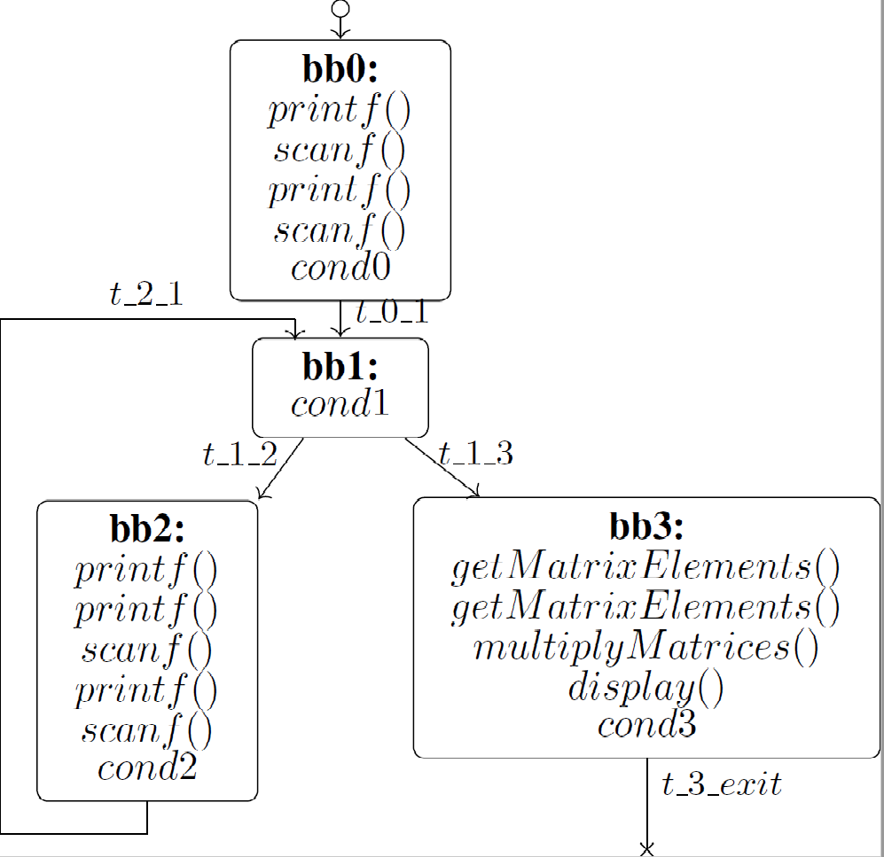

# The *RISCVmirToSMTfctCall.cpp* pass
This pass allows the generation of SMT formulae for a given application. An SMT file is generated for each function of the application. Compared to the *RISCVmirToSMT.cpp*, *RISCVmirToSMTfctCall.cpp* allows the detection of function-call instructions, which are declared as boolean variables in the SMT formula and then used as part of the constraints over the transitions. 

Our goal is to create a single SMT file (i.e. formula) for a given input application. To do so, we will use the function-call SMT variables in the generated SMT files to identify the different functions and their corresponding SMT formulae and combine them into a single one. This  *RISCVmirToSMTfctCall.cpp* pass help detect function calls at the MIR level and expose them in the SMT models. However, the combination of the different SMT files is conducted after the compilation process (i.e. after the SMT files are generated). 

To better explain how function calls are included in the SMT formula, we apply the *RISCVmirToSMTfctCall.cpp* pass on a matrice multiplication example. The CFG corresponding to the main function is shown in the figure below: . 

Only function calls and conditions are shown in each basic block. The pass detects all kinds of function calls including library and system calls. However, we are only interested in the program functions. In this example, there are only three program function calls:  `getMatrixElements()`, `multiplyMatrices` and `display()`, which take place in `bb3` of the `main()` function. 

This SMT pass, similarly to *RISCVmirToSMT.cpp* , attributes boolean variables to basic blocks (`bbi` for basic block number `i`), transitions between basic blocks (`t_i_j` between basic blocks `bbi` and `bbj` and `t_i_exit` if basic block `i` is an exit basic block) and conditions (`condi` for basic block `i`, which is the last instruction of a basic block). Additionally, it associates boolean variables to function-call instructions (`bbi_fct_name_k` for the occurence number `k` of function `fct_name` in basic block `i`). Keeping track of the number of occurences of a function in a basic block is crucial. The same function can be called more than once in the same basic block and to each call is associated a new SMT variable designating a different call context.     

The constraints over the transitions of the example above, taking into account function-call variables, are: 
- `t_0_1 = bb0 & cond0 & bb0_printf_0 & bb0_isoc99_scanf1 & bb0_printf2 & bb0_isoc99_scanf3` 
- `t_1_2 = bb1 & cond1`
- `t_1_3 = bb1 & not(cond1)`
- `t_2_1 = bb2 & cond2 & bb2_printf_0 & bb2_printf_1 & bb2_isoc99_scanf2 & bb2_printf_3 & bb2_isoc99_scanf4`
- `t_3_exit = bb3 & cond3 & bb3_getMatrixElements_0 & bb3_getMatrixElements_1 & bb3_multiplyMatrices_2 & bb3_display_3`

The complete SMT file (**smt_lib2_main.smt**) generated by this pass for the main function of the *multiply matrices* program is the following:

```
(set-logic QF_LIA)
(set-info :smt-lib-version 2.0)
(set-option :produce-models true)
(declare-fun bb0 () Bool)
(declare-fun bb1 () Bool)
(declare-fun t_0_1 () Bool)
(declare-fun cond_0 () Bool)
(declare-fun m_0_1 () Int)
(declare-fun t_2_1 () Bool)
(declare-fun cond_2 () Bool)
(declare-fun m_2_1 () Int)
(declare-fun bb2 () Bool)
(declare-fun t_1_2 () Bool)
(declare-fun cond_1 () Bool)
(declare-fun m_1_2 () Int)
(declare-fun bb3 () Bool)
(declare-fun t_1_3 () Bool)
(declare-fun m_1_3 () Int)
(declare-fun m_3_exit  () Int)
(declare-fun t_3_exit () Bool)
(declare-fun cond_3 () Bool)
(declare-fun mem_cost () Int)
(declare-fun bb0_printf_0 () Bool)
(declare-fun bb0___isoc99_scanf_1 () Bool)
(declare-fun bb0_printf_2 () Bool)
(declare-fun bb0___isoc99_scanf_3 () Bool)
(declare-fun bb2_printf_0 () Bool)
(declare-fun bb2_printf_1 () Bool)
(declare-fun bb2___isoc99_scanf_2 () Bool)
(declare-fun bb2_printf_3 () Bool)
(declare-fun bb2___isoc99_scanf_4 () Bool)
(declare-fun bb3_getMatrixElements_0 () Bool)
(declare-fun bb3_getMatrixElements_1 () Bool)
(declare-fun bb3_multiplyMatrices_2 () Bool)
(declare-fun bb3_display_3 () Bool)
(assert (= bb0 true))
(assert (= t_0_1 (and bb0 cond_0 bb0_printf_0 bb0___isoc99_scanf_1 bb0_printf_2 bb0___isoc99_scanf_3)))
(assert (= m_0_1 (ite t_0_1 4 0)))
(assert (= t_2_1 (and bb2 cond_2 bb2_printf_0 bb2_printf_1 bb2___isoc99_scanf_2 bb2_printf_3 bb2___isoc99_scanf_4)))
(assert (= m_2_1 (ite t_2_1 4 0)))
(assert (or (= bb1 t_0_1) (= bb1 t_2_1)))
(assert (= t_1_2 (and bb1 cond_1)))
(assert (= m_1_2 (ite t_1_2 2 0)))
(assert (= bb2 t_1_2))
(assert (= t_1_3 (and bb1 (not cond_1))))
(assert (= m_1_3 (ite t_1_3 2 0)))
(assert (= bb3 t_1_3))
(assert (= t_3_exit (and bb3 cond_3 bb3_getMatrixElements_0 bb3_getMatrixElements_1 bb3_multiplyMatrices_2 bb3_display_3)))
(assert (= m_3_exit 10))
(assert (= mem_cost (+  m_0_1 m_2_1 m_1_2 m_1_3 m_3_exit)))

```

To use the new pass, make sure to pass the following compilation flag to your  `llc` command line: `-smt-generation-fct-call`.
