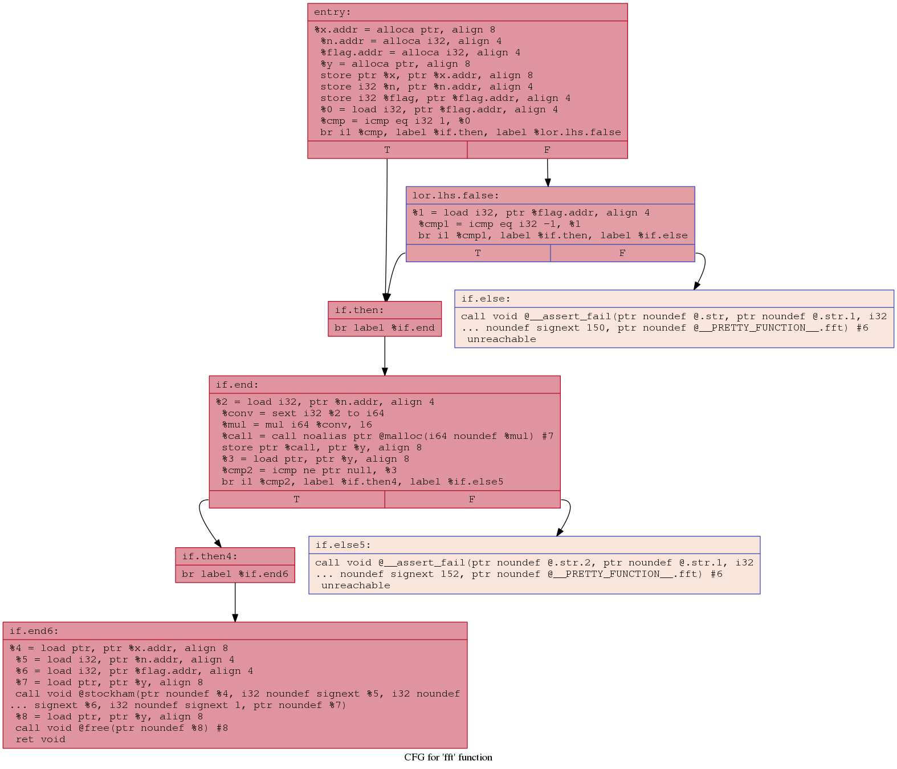

# A bash script to generate a cfg from a bitcode file

This script takes as input a bitcode file (e.g. *fft.bc*) and generates a CFG for each function in the input file. The generated files (e.g. *.fft.pdf* or *.fft.png*) are stored in a folder called `dotFiles`.

`.\cfgGenerator.sh fft.bc`  

To visualize the CFGs, here are a couple of options:

`xdg-open fft.pdf`

`eog fft.png`

Here is an example of the (scalar) fft function's CFG:  
A call to the function *stockham()* can be observed in the last basic block.

To compare two CFGs (for example the CFGs of scalar fft and vectorized fft), one could use `opt` and compare the basic block count, the loops, the number of instructions, the function calls, etc.
 
`path-to-llvm-build/bin/opt -stats -passes='print<func-properties>' fft.bc -disable-output 2>&1`

===-------------------------------------------------------------------------===

### Printing analysis results of CFA for function 'fft':

BasicBlockCount: 8

BlocksReachedFromConditionalInstruction: 6

Uses: 2

DirectCallsToDefinedFunctions: 1

LoadInstCount: 9

StoreInstCount: 4

MaxLoopDepth: 0

TopLevelLoopCount: 0

TotalInstructionCount: 35

### Printing analysis results of CFA for function 'stockham':

BasicBlockCount: 25

BlocksReachedFromConditionalInstruction: 16

Uses: 1

DirectCallsToDefinedFunctions: 0

LoadInstCount: 85

StoreInstCount: 34

MaxLoopDepth: 3

TopLevelLoopCount: 2

TotalInstructionCount: 251

### Printing analysis results of CFA for function 'main':

BasicBlockCount: 1

BlocksReachedFromConditionalInstruction: 0

Uses: 1

DirectCallsToDefinedFunctions: 1

LoadInstCount: 2

StoreInstCount: 1

MaxLoopDepth: 0

TopLevelLoopCount: 0

TotalInstructionCount: 10

===-------------------------------------------------------------------------===

